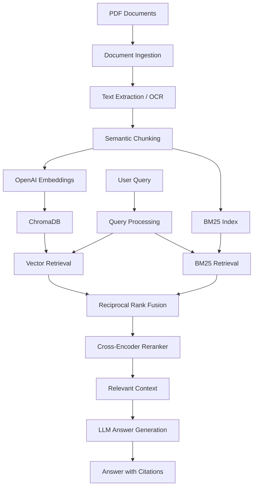

# Personal AI Knowledge Assistant

A Retrieval-Augmented Generation (RAG) application that allows users to query their personal PDF knowledge base and receive context-grounded answers with source citations.

The system combines semantic search, BM25 keyword retrieval, Reciprocal Rank Fusion (RRF), and cross-encoder reranking to improve retrieval quality. It also supports scanned and handwritten PDF processing through OCR.


## Features

- **PDF Ingestion:** Extracts and processes content from PDF documents.
- **OCR Support:** Handles scanned and handwritten PDF pages using an OCR pipeline.
- **Semantic Chunking:** Splits documents into meaningful chunks for retrieval.
- **Vector Search:** Generates embeddings using OpenAI's `text-embedding-3-small` and stores them in ChromaDB.
- **BM25 Retrieval:** Supports keyword-based document retrieval.
- **Hybrid Retrieval:** Combines vector and BM25 results using Reciprocal Rank Fusion.
- **Cross-Encoder Reranking:** Reorders retrieved candidates based on query relevance.
- **Conversational Queries:** Supports chat history and query rewriting for follow-up questions.
- **Source Citations:** Provides source filenames and PDF page references alongside answers.
- **Relevance Filtering:** Can abstain when the retrieved information is insufficient.
- **Evaluation:** Measures retrieval performance, faithfulness, and answer correctness.

## Architecture



## Retrieval Pipeline

The retrieval pipeline uses multiple stages:

1. **Vector Retrieval:** Finds semantically similar document chunks.
2. **BM25 Retrieval:** Finds documents based on keyword relevance.
3. **Reciprocal Rank Fusion:** Combines rankings from both retrieval methods.
4. **Cross-Encoder Reranking:** Reranks the fused candidates to select the most relevant context.
5. **Answer Generation:** Passes the selected context to the LLM to generate a grounded response.

## Evaluation

The system was evaluated using a custom question-answer dataset built from technical PDFs.

### Retrieval Evaluation

| Retrieval Strategy | Hit@5 | MRR |
|---|---:|---:|
| BM25 | 68% | 0.55 |
| Vector Search | 92% | 0.71 |
| Hybrid (RRF) | 82% | 0.59 |
| Hybrid + Reranking | 90% | 0.72 |

**Observations:**
- Vector retrieval achieved the highest Hit@5.
- Hybrid retrieval with reranking achieved the highest MRR.
- Reranking improved the ordering of relevant results compared with the initial hybrid retrieval.

### Generation Evaluation

| Metric | Score |
|---|---:|
| Faithfulness | 0.95 |
| Answer Correctness | 0.70 |

- **Faithfulness:** Evaluates whether generated claims are supported by the retrieved context.
- **Answer Correctness:** Evaluates how closely generated answers match reference answers.

These results are experimental measurements on the project's evaluation dataset, not guarantees of performance on arbitrary documents.

## Tech Stack

| Component | Technology |
|---|---|
| Language | Python |
| LLM | OpenAI API |
| Embeddings | `text-embedding-3-small` |
| Vector Database | ChromaDB |
| Keyword Retrieval | BM25 |
| Rank Fusion | Reciprocal Rank Fusion |
| Reranking | `cross-encoder/ms-marco-MiniLM-L-6-v2` |
| PDF Processing | PyMuPDF |
| OCR | OpenAI Vision |
| RAG Framework | LangChain |
| Evaluation | Ragas |
| Interface | Streamlit |

## Project Structure

```text
Personal_AI_Knowledge_Assistant/
│
├── src/
│   ├── Ingestion/
│   ├── Retrieval/
│   ├── LLM/
│   ├── evaluation.py
│   ├── generation_evaluation.py
│   ├── app.py
│   └── main.py
│
├── eval/
│   ├── questions.json
│   └── generation_results_90.csv
│
├── vector_store/
│   └── chroma_db/
│
├── .env.example
├── requirements.txt
└── README.md
```

*The structure above is a representative overview; adjust filenames to match the final repository.*

## Setup and Installation

### 1. Clone the repository

```bash
git clone https://github.com/Madhavan-030828/Personal_AI_Knowledge_Assistant.git
cd Personal_AI_Knowledge_Assistant
```

### 2. Create a virtual environment

```bash
python -m venv .venv
```

Activate it:

**Windows**
```bash
.venv\Scripts\activate
```

**macOS / Linux**
```bash
source .venv/bin/activate
```

### 3. Install dependencies

```bash
pip install -r requirements.txt
```

### 4. Configure environment variables

Create a `.env` file in the project root:

```env
OPENAI_API_KEY=your_openai_api_key
```

### 5. Run the application

```bash
streamlit run src/app.py
```

## Evaluation

Run retrieval evaluation:

```bash
python src/evaluation.py
```

Run generation evaluation:

```bash
python src/generation_evaluation.py
```

## Future Improvements

- Improve answer correctness through better answer generation and evaluation.
- Expand the evaluation dataset across more document types and question categories.
- Improve retrieval performance for exact-match queries.
- Add more robust handling of ambiguous and out-of-scope questions.

## Author

**Madhavan**

[Linkedin](https://www.linkedin.com/in/madhavan-k-6a4468330)
